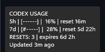
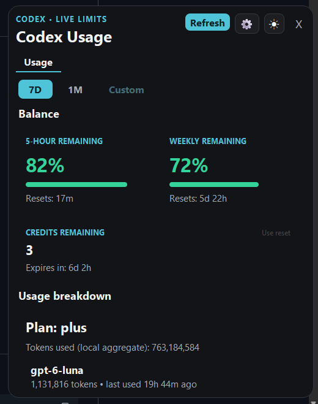
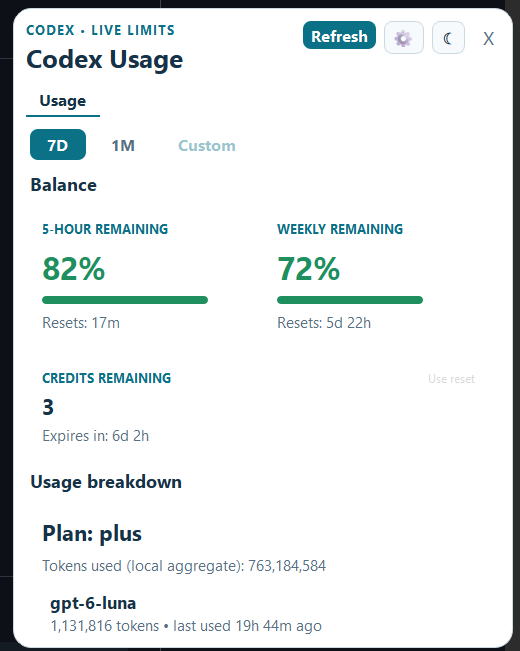

# AI Usage Tray

Windows system tray app for monitoring OpenAI Codex usage, with browser-based PKCE authentication.

## Features

- **System tray icon** that changes color based on usage:
  - 🟢 Green: 0-59%
  - 🟠 Orange: 60-84%
  - 🔴 Red: 85%+
- **Tooltip with compact progress bars** and reset countdowns
- **Browser-based OAuth** with PKCE (no device codes)
- **Codex Usage dashboard** with live usage display (5h hourly + 7d weekly windows)
- **Use reset** action that opens Codex beside the remaining reset credits
- **Show Sections toggles** for Balance, Credits, Usage breakdown, Local activity, and History
- **Group by Day** averaging for usage snapshots, available only with History visible
- **Reset credits** counter with countdown timers
- **Dashboard theme toggle** with persistent light and dark modes
- **Recent model activity** showing models used within the last 72 hours
- **Launch on Startup** enabled by default via Windows registry, with tray and Settings opt-out
- **Catppuccin Mocha** themed settings window with PyQt6
- **Standalone .exe**, no Python installation required

## Screenshots

### Tray tooltip



The tray icon is green below 60%, orange from 60% through 84%, and red at
85% or higher. Reset-credit notifications appear one hour and fifteen minutes
before the nearest available credit expires.

### Dashboard — dark mode



### Dashboard — light mode



The dashboard opens from the tray icon as Codex Usage and includes live limit cards, reset
credit details, local session activity, usage history, and locally observed
token/model metadata when available. The model section shows only activity from
the last 72 hours, and the theme button switches between light and dark mode.
The settings (gear) panel offers Show Sections toggles for Balance, Credits,
Usage breakdown, Local activity, and History. Group by Day averages
usage snapshots per day and is shown only when History is visible.

## Quick Start

```bash
cd python
pip install -r requirements.txt
python main.py
```

## Authentication

1. Right-click the tray icon → **Login to Codex**
2. Browser opens to OpenAI login
3. Authenticate with your OpenAI account
4. Token is saved to `~/.codex/auth.json`

The app uses a browser-based PKCE OAuth flow with an authorization code and S256 code verifier; no device codes or API keys are needed.

## Auto-Start

Launch on startup is enabled by default (`launch_on_startup: true`).

- **Tray menu**: Right-click → **Launch on Startup** (uncheck to opt out)
- **Settings window**: Startup tab → **Launch on Windows Startup** (uncheck to opt out)

Uses `HKCU\Software\Microsoft\Windows\CurrentVersion\Run` registry key.

## Configuration

Stored in `%LocalAppData%\AI-Usage-Tray\config.json`:

```json
{
  "refresh_interval_seconds": 300,
  "cache_ttl_seconds": 55,
  "notifications_enabled": true,
  "notify_warn_threshold": 80,
  "notify_critical_threshold": 95,
  "notify_cooldown_minutes": 15,
  "reset_credit_notify_60_minutes": 60,
  "reset_credit_notify_15_minutes": 15,
  "codex_enabled": true,
  "launch_on_startup": true,
  "display_mode": "icon",
  "dark_mode": false,
  "section_visibility": {
    "balance": true,
    "credits": true,
    "usage_breakdown": true,
    "local_activity": true,
    "history": true
  }
}
```

## Releases

v1.0.10 Windows installer: [AIUsageTray-Windows.exe](https://github.com/JaredJomar/ai-usage-tray/releases/download/v1.0.10/AIUsageTray-Windows.exe)
from the [v1.0.10 release](https://github.com/JaredJomar/ai-usage-tray/releases/tag/v1.0.10).
Built from `Installer/AIUsageTray-Windows.exe` via `Installer/AIUsageTray.iss`.

## API

Usage data is fetched from:
```
GET https://chatgpt.com/backend-api/wham/usage
Authorization: Bearer {access_token}
User-Agent: codex_cli_rs
```

Response includes `rate_limit.primary_window` (5h), `rate_limit.secondary_window` (7d),
`rate_limit_reset_credits`, and `plan_type`. Available reset-credit expiry details
are fetched from:
```
GET https://chatgpt.com/backend-api/wham/rate-limit-reset-credits
Authorization: Bearer {access_token}
```

## Architecture

```
AI-Usage-Tray/
├── python/
│   ├── main.py              # Entry point
│   ├── config.py            # Configuration management
│   ├── auth.py              # PKCE browser OAuth + token refresh
│   ├── tray.py              # Tray icon, tooltip, menu, auto-start
│   ├── settings_window.py   # PyQt6 settings with live usage display
│   ├── cache.py             # TTL cache with atomic writes
│   ├── logger.py            # File logging
│   ├── providers/
│   │   ├── __init__.py
│   │   └── codex.py         # Codex usage API
│   ├── icon.ico             # App icon
│   └── requirements.txt
└── README.md
```

## Credits

- Inspired by [Omarchy](https://omarchy.org/)'s AI usage widget

## License

MIT
