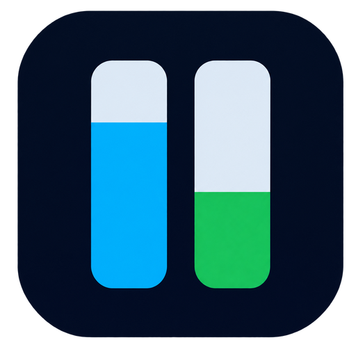
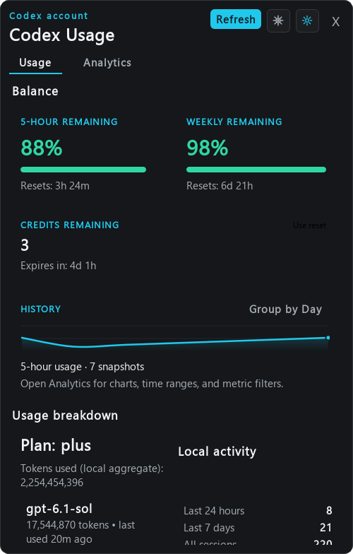
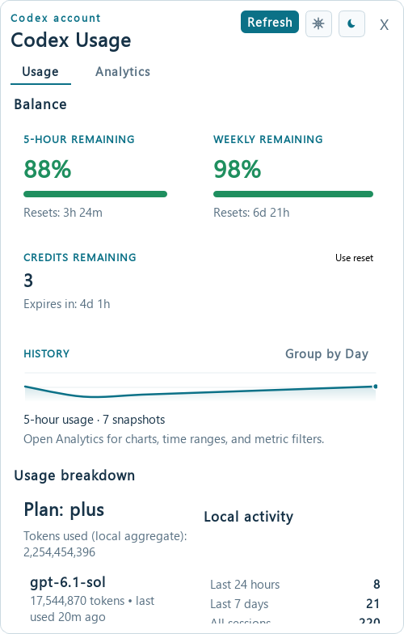
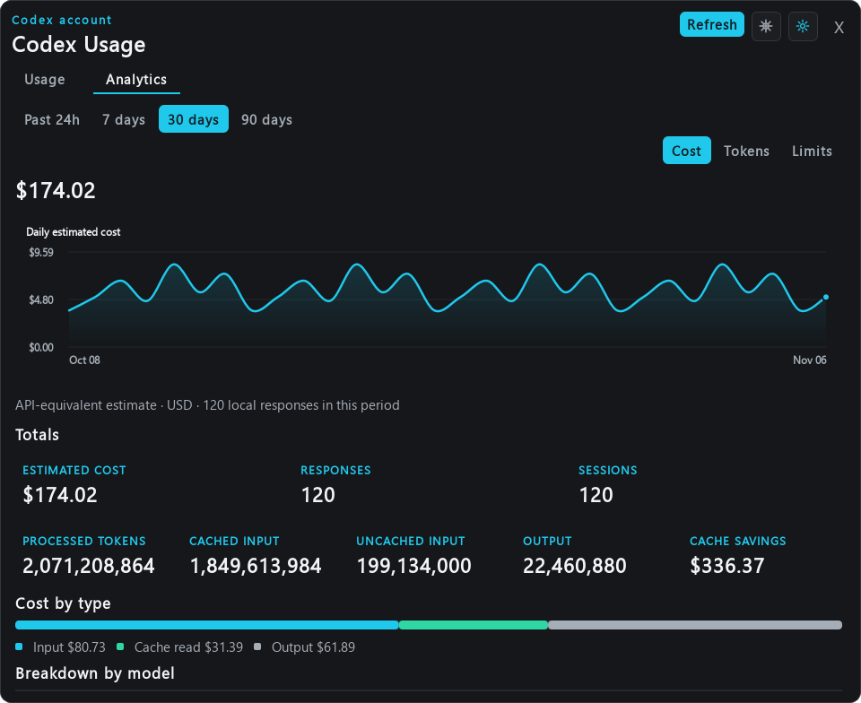
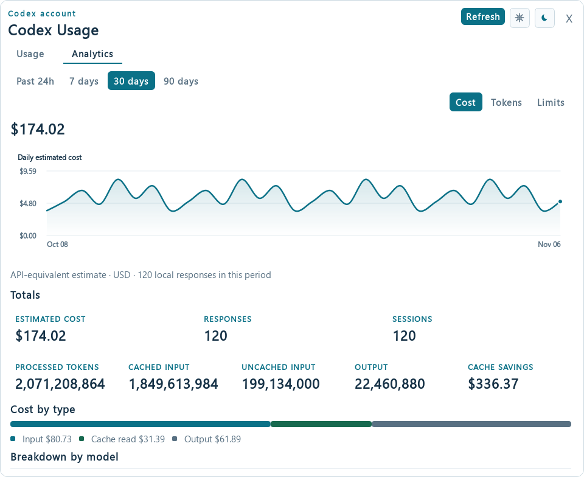
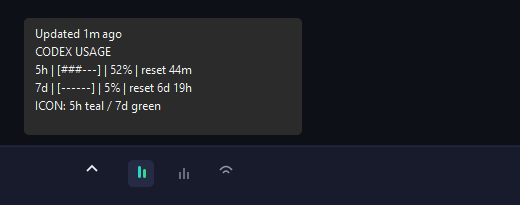

# AI Usage Tray

Windows system tray app for monitoring Codex limits and local AI token usage, with browser-based PKCE authentication.

## Features

- **System tray icon** with separate 5-hour and weekly meters, rendered at multiple Windows icon sizes.
- **Tooltip with compact progress bars** and reset countdowns
- **Browser-based OAuth** with PKCE (no device codes)
- **Codex Usage dashboard** with live usage display (5h hourly + 7d weekly windows)
- **Use reset** action that confirms and attempts to consume an available reset credit before it expires
- **Show Sections toggles** for Balance, Credits, Usage breakdown, Local activity, and History
- **Group by Day** averaging for usage snapshots, available only with History visible
- **Reset credits** counter with countdown timers
- **Dashboard theme toggle** with persistent light and dark modes
- **Recent model activity** showing models used within the last 72 hours
- **Launch on Startup** enabled by default via Windows registry, with tray and Settings opt-out
- **Catppuccin Mocha** themed settings window with PyQt6
- **Standalone .exe**, no Python installation required

The tray icon uses a cyan left gauge for 5-hour usage and a green right gauge
for weekly usage; each fill shows that window's used percentage. Reset-credit
notifications appear 60, 30, 15, and 5 minutes
before an available credit expires. If the app wakes after earlier thresholds,
it sends only the nearest relevant alert. Alerts are deduplicated per credit
and expiry time.

Choose **Use reset** in the dashboard to redeem a credit before it expires,
even with remaining balance above 0%. The app does not require either usage
window to be exhausted; the service still decides whether to accept the request.

## Screenshots

Screenshots use sample values and contain no local account or usage data.

The app icon uses the same cyan and green meters as the tray status icon. The
ICO includes 16, 24, 32, 48, 64, 128, and 256 pixel variants.



### Usage

| Dark mode | Light mode |
| --- | --- |
|  |  |

### Analytics

Analytics includes cost estimates and token totals, daily charts, type
breakdowns, and model rankings. Its 24-hour, 7-day, 30-day, and 90-day ranges
are separate from the Usage tab.

| Dark mode | Light mode |
| --- | --- |
|  |  |

### Tray tooltip



The dashboard keeps Usage and Analytics in separate tabs. Usage contains live
limit cards, reset-credit details, local session activity, usage history, and
locally observed token/model metadata. Analytics estimates API-equivalent USD
cost from local Codex and OpenCode token records; it does not show subscription
charges. OpenCode accounting reads only model and token metadata from its local
database. Free or unknown models remain unpriced rather than receiving a
fabricated cost. The settings panel controls visibility of Usage sections,
and Group by Day averages saved snapshots when History is visible.

Local activity is collected read-only from Codex metadata under `~/.codex`,
including `state_5.sqlite` and eligible rollout JSONL files. The app uses
aggregate session, token, model, and rate-limit metadata; it does not read
prompts or message text. Current limits are fetched from the Wham API.

## Quick Start

For a source checkout, use Windows with Python 3.13 or a compatible Python 3
installation. The automated Windows build currently uses Python 3.13.

```bash
cd python
pip install -r requirements.txt
python main.py
```

The application starts in the system tray. Use `python main.py --dashboard` to
open the dashboard directly, or `python main.py --settings` to open Settings.

## Testing and Packaging

Run the test suite from the `python` directory:

```bash
python -m pytest tests -q
```

Pushing a `v*` tag or starting the GitHub Actions workflow manually runs the
Windows build. The workflow tests the source, builds a PyInstaller onedir
payload, smoke-tests the frozen executable, verifies its Brotli runtime, and
compiles the Inno Setup installer. Tag builds attach
`Installer/AIUsageTray-Windows.exe` to the release.

## Authentication

1. Right-click the tray icon → **Login to Codex**
2. Browser opens to OpenAI login
3. Authenticate with your OpenAI account
4. Token is saved to `~/.codex/auth.json`

The app uses a browser-based PKCE OAuth flow with an authorization code and S256 code verifier; no device codes or API keys are needed.

## Auto-Start

Launch on startup is enabled by default (`launch_on_startup: true`).

- **Tray menu**: Right-click → **Launch on Startup** (uncheck to opt out)
- **Settings window**: Startup tab → **Launch on Windows Startup** (uncheck to opt out)

Uses `HKCU\Software\Microsoft\Windows\CurrentVersion\Run` registry key.

## Configuration

Stored in `%LocalAppData%\AI-Usage-Tray\config.json`:

```json
{
  "refresh_interval_seconds": 300,
  "cache_ttl_seconds": 55,
  "notifications_enabled": true,
  "notify_warn_threshold": 80,
  "notify_critical_threshold": 95,
  "notify_cooldown_minutes": 15,
  "reset_credit_notify_60_minutes": 60,
  "reset_credit_notify_30_minutes": 30,
  "reset_credit_notify_15_minutes": 15,
  "reset_credit_notify_5_minutes": 5,
  "codex_enabled": true,
  "launch_on_startup": true,
  "display_mode": "icon",
  "dark_mode": false,
  "section_visibility": {
    "balance": true,
    "credits": true,
    "usage_breakdown": true,
    "local_activity": true,
    "history": true
  }
}
```

Existing configuration files without the 30-minute or 5-minute fields load
with these defaults. The dashboard's **Use reset** action asks for confirmation,
then sends a consume request for any available credit without requiring the
weekly quota to be exhausted. A successful result is shown only when the API
reports a recognized success outcome; server rejections are displayed as
failures, and early-consumption eligibility remains controlled by the service.

## Releases

v1.0.13 Windows installer: [AIUsageTray-Windows.exe](https://github.com/JaredJomar/ai-usage-tray/releases/download/v1.0.13/AIUsageTray-Windows.exe)
from the [v1.0.13 release](https://github.com/JaredJomar/ai-usage-tray/releases/tag/v1.0.13).
Built from `Installer/AIUsageTray-Windows.exe` via `Installer/AIUsageTray.iss`.

## API

Usage data is fetched from:
```
GET https://chatgpt.com/backend-api/wham/usage
Authorization: Bearer {access_token}
User-Agent: codex_cli_rs
```

Response includes `rate_limit.primary_window` (5h), `rate_limit.secondary_window` (7d),
`rate_limit_reset_credits`, and `plan_type`. Available reset-credit expiry details
are fetched from:
```
GET https://chatgpt.com/backend-api/wham/rate-limit-reset-credits
Authorization: Bearer {access_token}
```

## Architecture

```
AI-Usage-Tray/
├── python/
│   ├── main.py              # Entry point
│   ├── config.py            # Configuration management
│   ├── auth.py              # PKCE browser OAuth + token refresh
│   ├── tray.py              # Tray icon, tooltip, menu, auto-start
│   ├── dashboard.py         # PyQt6 usage dashboard and local activity views
│   ├── settings_window.py   # PyQt6 settings with live usage display
│   ├── local_codex.py       # Read-only Codex and OpenCode usage metadata
│   ├── cache.py             # TTL cache with atomic writes
│   ├── logger.py            # File logging
│   ├── providers/
│   │   ├── __init__.py
│   │   └── codex.py         # Codex usage API
│   ├── icon.ico             # App icon
│   └── requirements.txt
└── README.md
```

## Credits

- Inspired by [Omarchy](https://omarchy.org/)'s AI usage widget

## License

MIT
